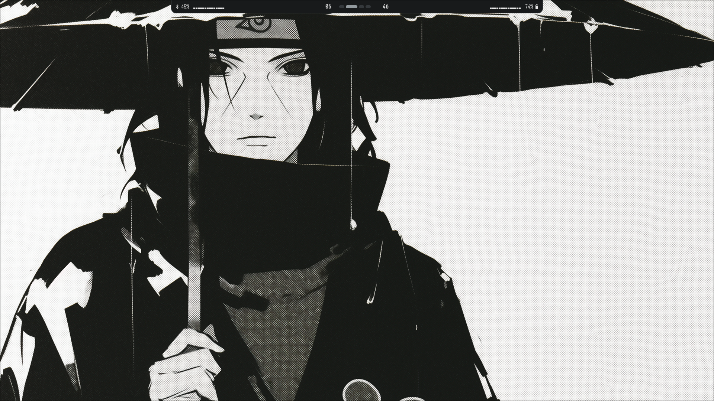
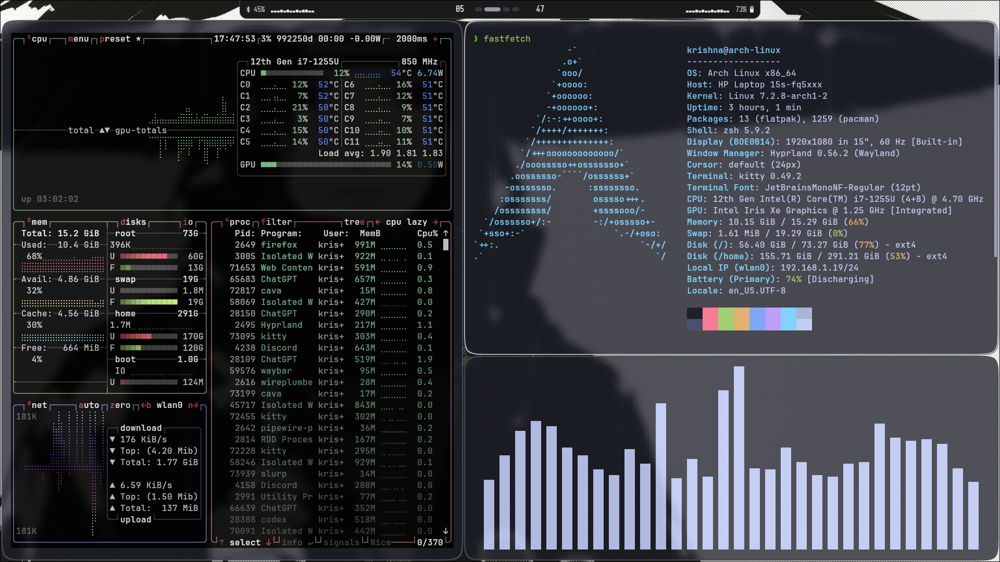
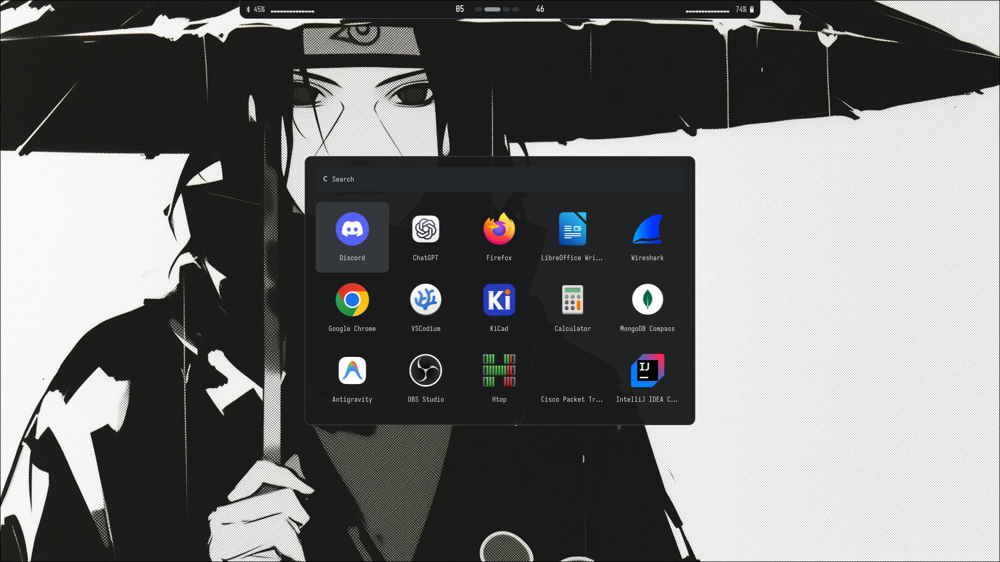
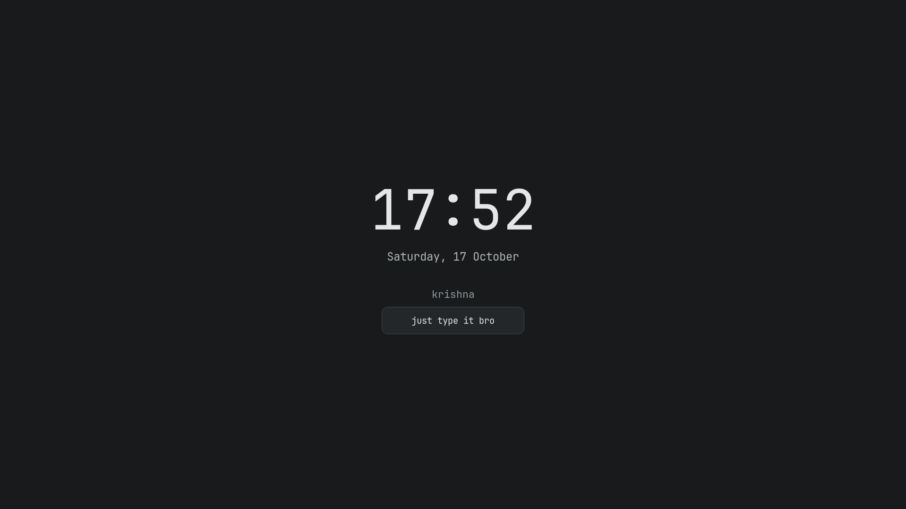

# HyprlandLua 🌙

A minimal, highly modular, **Lua-powered Hyprland setup** for Arch Linux. Featuring Waybar, Rofi, Kitty, Cava, screenshot utilities, and a neutral charcoal and gray theme.


---

## 📸 Showcase

| Clean Desktop | Terminals & Visualizer |
| :---: | :---: |
|  |  |

| App Launcher (Rofi) | Lockscreen (Hyprlock) |
| :---: | :---: |
|  |  |

---

## ✨ Features

* **100% Lua-Based:** Hyprland configured entirely through Lua for ultimate scriptability.
* **Modular Structure:** Clean, separated configuration modules that are easy to read and maintain.
* **Neutral Theme:** Charcoal surfaces, soft white text, and gray accents across Rofi, Waybar, Hyprlock, and window borders.
* **Cava Integration:** Audio visualizer with multiple custom GLSL shaders (Spectrogram, Northern Lights, Orion, Winamp-style) and color themes.
* **Clipboard History:** Quick clipboard access using `cliphist` and Rofi (`SUPER + A`).
* **Dynamic Wallpapers:** Switch between wallpapers using `ALT + 1-9`, or hit `ALT + 0` to select a random wallpaper!
* **Included Scripts:** Custom utilities for screenshots and Waybar reloading.

---

## 📂 Folder Structure

```text
hyprlandLua/
├── LICENSE
├── README.md
└── .config
    ├── cava
    │   ├── config
    │   ├── shaders/
    │   │   ├── bar_spectrum.frag
    │   │   ├── eye_of_phi.frag
    │   │   ├── northern_lights.frag
    │   │   ├── orion_circle.frag
    │   │   ├── spectrogram.frag
    │   │   └── winamp_line_style_spectrum.frag
    │   └── themes/
    │       ├── solarized_dark
    │       └── tricolor
    ├── hypr
    │   ├── hyprland.lua
    │   ├── hyprlock.conf
    │   └── modules
    │       ├── autostart.lua
    │       ├── binds.lua
    │       ├── decorations.lua
    │       ├── env.lua
    │       ├── input.lua
    │       ├── layout.lua
    │       ├── misc.lua
    │       ├── monitors.lua
    │       └── windowrules.lua
    ├── kitty
    │   └── kitty.conf
    ├── rofi
    │   ├── clipboard.rasi
    │   ├── colors/
    │   ├── scripts/
    │   │   └── launcher.sh
    │   └── style.rasi
    ├── screenshot
    │   └── screenshot-script.sh
    ├── wallpaper
    │   ├── pic1.png
    │   └── ... (your wallpapers here)
    └── waybar
        ├── colors/
        ├── config.jsonc
        ├── scripts/
        │   └── launch.sh
        └── style.css
```

## 🗺️ File Locations

| Component | Path |
| :--- | :--- |
| **Main Hyprland Config** | `~/.config/hypr/hyprland.lua` |
| **Hyprlock Config** | `~/.config/hypr/hyprlock.conf` |
| **Keybindings** | `~/.config/hypr/modules/binds.lua` |
| **Decorations & Animations** | `~/.config/hypr/modules/decorations.lua` |
| **Window Rules** | `~/.config/hypr/modules/windowrules.lua` |
| **Cava Audio Config** | `~/.config/cava/config` |
| **Cava Shaders** | `~/.config/cava/shaders/` |
| **Wallpapers Directory** | `~/.config/wallpaper/` |
| **Kitty Config** | `~/.config/kitty/kitty.conf` |
| **Rofi Theme** | `~/.config/rofi/style.rasi` |
| **Waybar Config** | `~/.config/waybar/config.jsonc` |
| **Screenshot Script** | `~/.config/screenshot/screenshot-script.sh` |

---

## 📦 Dependencies

### Hyprland Compatibility

This configuration requires Hyprland's native Lua configuration support and the `hl` API. See the [Hyprland 0.55.0 configuration guide](https://wiki.hypr.land/0.55.0/Configuring/Start/) for the Lua configuration format. Installing standalone Lua does not add Lua configuration support to older Hyprland builds.

Check your installed version with `hyprctl version`. The desktop configuration has been exercised on Hyprland 0.56.2 with Hyprlock 0.9.6. The Lua API may differ between releases.

### Core (Required)
```bash
sudo pacman -S hyprland hyprlock waybar rofi kitty wl-clipboard cliphist swaync
```
Current Arch Linux `rofi` packages include native Wayland support. Older distributions may still package it separately as `rofi-wayland`.

### Optional (Used in this Setup)
```bash
# Audio, brightness, screenshots, visualizer, and notifications
sudo pacman -S cava brightnessctl wireplumber playerctl grim slurp pavucontrol libnotify
```
`wireplumber` provides `wpctl` for the volume and microphone bindings and requires a working PipeWire audio session. `libnotify` provides optional screenshot notifications. Install `awww` separately for wallpaper switching; autostart launches `awww-daemon`.

### Personal Application Shortcuts

These applications are optional. Install them or change the corresponding commands in `hyprland.lua` and `modules/binds.lua`:

| Shortcut | Command | Application / Arch package |
| :--- | :--- | :--- |
| `SUPER + E` | `nautilus` | Files (`nautilus`) |
| `SUPER + F` | `firefox` | Firefox (`firefox`) |
| `SUPER + W` | `kitty -e nmtui` | NetworkManager TUI (`networkmanager`) |
| `SUPER + B` | `blueman-manager` | Bluetooth manager (`blueman`) |
| `SUPER + I` | `idea` | IntelliJ IDEA; ensure its launcher is on `PATH` |

### Fonts

The themes reference Iosevka Nerd Font (including the Propo variant) and JetBrainsMono Nerd Font. Install these fonts or update the font settings in Waybar, Rofi, Kitty, and Hyprlock to match your installed fonts.

---

## 🚀 Installation Guide

**1. Clone the Repository**
```bash
git clone https://github.com/KrishnaX12/hyprlandLua.git
cd hyprlandLua
```

**2. Make Scripts Executable**
```bash
chmod +x .config/rofi/scripts/launcher.sh .config/screenshot/screenshot-script.sh .config/waybar/scripts/launch.sh
```

**3. Back Up and Copy Configuration Files**

Back up any existing `~/.config/{cava,hypr,kitty,rofi,screenshot,wallpaper,waybar}` directories before continuing. The copy command below merges directories and overwrites matching files.

```bash
mkdir -p ~/.config
cp -r .config/* ~/.config/
```

**4. Start the Session**

Review `hyprland.lua` and `modules/monitors.lua` for your applications and displays. Log out and start a new Hyprland session after the first installation so the `hyprland.start` handler launches Waybar, SwayNC, the wallpaper daemon, and clipboard history.

For later configuration edits, reload without restarting the session:

```bash
hyprctl reload
```

Reloading does not rerun the `hyprland.start` handler.

---

## Theme

Rofi uses `.config/rofi/colors/neutral.rasi`; Waybar uses `.config/waybar/colors/neutral.css`. Hyprlock colors are in `.config/hypr/hyprlock.conf`, and window borders are in `.config/hypr/modules/decorations.lua`.

The palette uses charcoal `#181a1b`, white text `#e6e6e6`, gray accents `#939a9e`, and light active borders `#b8bec2`. Error and warning colors remain red and yellow. Waybar keeps the original volume/visualizer, centered clock/workspaces, and visualizer/battery layout.

After copying the files, reopen Rofi, reload Waybar with `SUPER + R`, and run `hyprctl reload` for window borders. Hyprlock reads its theme the next time you lock with `SUPER + L`.

## 📝 Notes

> ⚠️ **Disclaimer:** Always back up your existing `~/.config` files before installation!

* Built and tested heavily on Arch Linux.
* Feel free to fork, modify, and improve. If you add cool new Lua modules, pull requests are welcome!

## License

The configuration and scripts are available under the [MIT License](LICENSE). Bundled wallpapers and third-party shaders retain their original authors’ rights and licenses.
